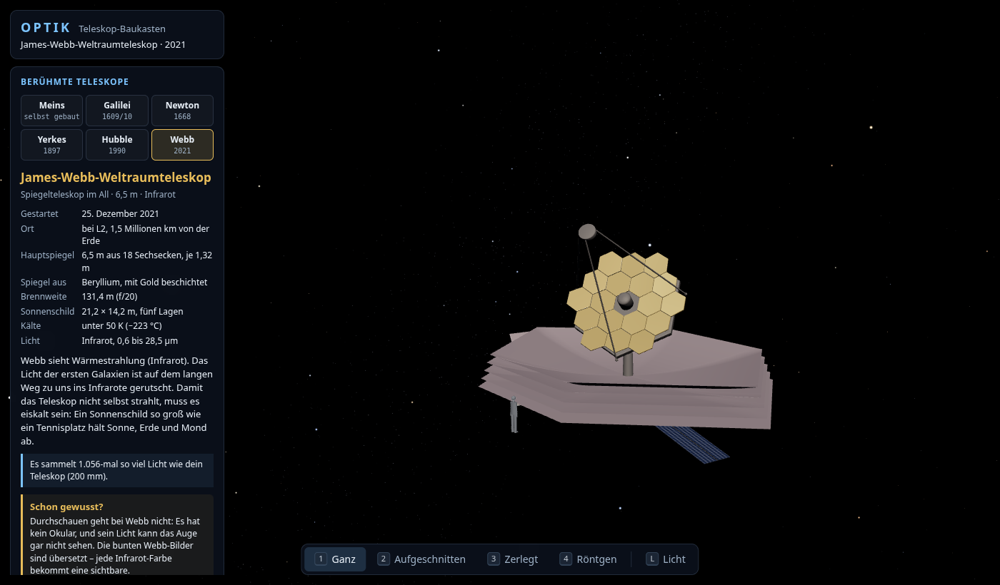

# OPTIK – Teleskop-Baukasten

Ein Teleskop in 3D unter einem Sternenhimmel – zum Drehen, Aufschrauben und
Durchschauen.



> **Im Aufbau.** Fertig sind Etappe 1 bis 7 von 8: ein Spiegelteleskop
> (Dobson) und ein Linsenfernrohr zum Ansehen, Aufschneiden, Zerlegen und
> Selbstbauen, mit dem Licht eines Sterns, das man bis ins Okular laufen
> sieht – und zum Hindurchschauen, so wie genau dieses Teleskop den
> Himmel zeigen würde. Beim Linsenfernrohr sieht man, warum eine einzelne
> Linse bunte Ränder macht und wie zwei Glassorten das beheben. Dazu fünf
> berühmte Teleskope zum Aufschrauben: Galileis Fernrohr (1609/10), Newtons
> erstes Spiegelteleskop (1668), der Yerkes-Refraktor (1897) und im All
> Hubble (1990, mit seinem berühmten Spiegelfehler zum Einschalten) und
> Webb (2021). Was noch kommt, steht in [`OPTIK-Plan.md`](OPTIK-Plan.md).

## Starten

`index.html` doppelklicken. Kein Server, kein Build, keine Installation. Die
Seite lädt **nichts** aus dem Netz. Gebraucht wird ein Browser mit WebGL
(aktueller Firefox, Chrome oder Edge).

## Bedienung

| Eingabe | Wirkung |
| --- | --- |
| Ziehen | um das Teleskop herum drehen |
| Mausrad, zwei Finger kneifen | zoomen |
| rechte Maustaste ziehen | verschieben |
| `1` `2` `3` `4` | ganz / aufgeschnitten / zerlegt / Röntgen |
| Klick auf ein Teil oder Schild | Infokarte: wozu, woraus, Zahlen, ein Fakt |
| `Esc` | Infokarte schließen |
| `L` | Sternlicht an/aus; Regler: Stern neben die Mitte schieben |
| `O` / Durchschauen | durchs Okular schauen (vorher schwenkt das Teleskop zum Objekt), `Esc` zurück – auch durch Galileis, Newtons und das Yerkes-Teleskop |
| Links: Berühmte Teleskope | Galilei, Newton, Yerkes, Hubble, Webb – mit Steckbrief; „Meins“ zurück zum eigenen |
| Links: Beobachten | Objekt und Luft wählen |
| Links: Selbst bauen | Vorlagen, Öffnung, Brennweite, Okular – das Teleskop baut sich sofort um |
| Links: Datenblatt | Zeile anklicken für die Erklärung |
| `F` | ganzes Teleskop zeigen |
| `P` | Bildrate ein/aus (steht still bei 0, wenn sich nichts bewegt) |

## Was daran stimmt

Das Licht ist nicht aufgemalt: Jeder Strahl wird durch Parabolspiegel,
Fangspiegel, Feldblende und Okular verfolgt. Alle treffen sich auf
10⁻¹² mm genau im Brennpunkt, der Fangspiegel schattet 6,3 % der Fläche ab,
und am Bildrand wird es dunkler, weil dort Licht den Fangspiegel verfehlt –
wie bei echten Newton-Teleskopen.

Beim Linsenfernrohr wird jeder Strahl in drei Farben durch echtes Glas
gerechnet (Sellmeier-Formel, Kron- und Flintglas): Bei einer einzelnen
Linse liegen der rote und der blaue Brennpunkt 9,3 mm auseinander (die
Faustregel f/V sagt 9,4 mm), beim Achromat, aus der Formel berechnet, nur
0,15 mm. Im Okular wird daraus ein violetter Saum.

Der Blick durchs Okular rechnet mit echten Winkelgrößen (Saturn 18″, die
Cassini-Teilung 0,7″), mit der Unschärfe aus Beugung und Luftunruhe, der
Helligkeit nach der Austrittspupille und der Grenzgröße für Sterne. Bei
ruhiger Luft zeigt ein 300-mm-Spiegel die Cassini-Teilung mit 67 %
Kontrast, ein 100-mm-Spiegel mit 28 % – bei unruhiger Luft keiner von
beiden. Ein Bildschirm hat zu wenig Pixel für das, was das Auge im Okular
sieht; deshalb zeigt eine Lupe die Bildmitte so fein wie das Auge.

Das Modell ist vereinfacht, aber die Maße kommen aus der Optik: Der
Hauptspiegel ist eine echte Parabel (bei 200/1200 am Rand 2,08 mm tief), der
Fangspiegel sitzt genau dort, wo der Brennpunkt oben im Okularauszug landet,
und ist gerade so groß, dass er den Lichtkegel nicht anschneidet. Geprüft
wird das ohne Browser:

```bash
node pruefungen/strahlen-test.js
```

## Bausteine

- [three.js](https://threejs.org) r128 (MIT-Lizenz), lokal in `lib/`
- alles andere selbst geschrieben, alle Texturen werden beim Start gerechnet

---

Erstellt mit Unterstützung von KI (Claude).
