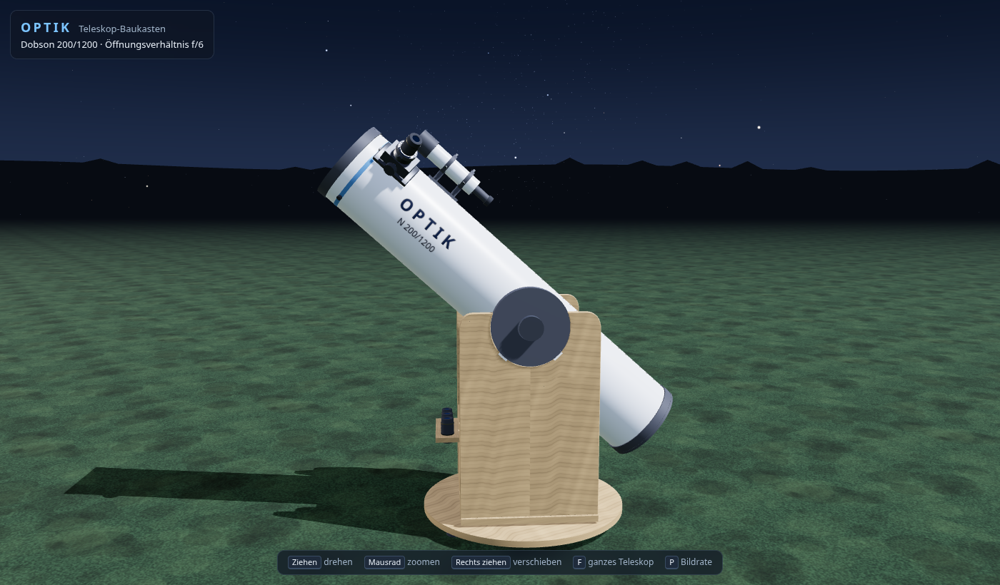

# OPTIK – Teleskop-Baukasten

Ein Teleskop in 3D unter einem Sternenhimmel – zum Drehen, Aufschrauben und
Durchschauen.



> **Im Aufbau.** Fertig ist Etappe 1 von 8: ein Dobson-Teleskop 200/1200,
> das man von allen Seiten ansehen kann. Was noch kommt – Aufschrauben,
> Licht im Tubus, selbst bauen, durchs Okular schauen, berühmte Teleskope –
> steht in [`OPTIK-Plan.md`](OPTIK-Plan.md).

## Starten

`index.html` doppelklicken. Kein Server, kein Build, keine Installation. Die
Seite lädt **nichts** aus dem Netz. Gebraucht wird ein Browser mit WebGL
(aktueller Firefox, Chrome oder Edge).

## Bedienung

| Eingabe | Wirkung |
| --- | --- |
| Ziehen | um das Teleskop herum drehen |
| Mausrad, zwei Finger kneifen | zoomen |
| rechte Maustaste ziehen | verschieben |
| `F` | ganzes Teleskop zeigen |
| `P` | Bildrate ein/aus (steht still bei 0, wenn sich nichts bewegt) |

## Was daran stimmt

Das Modell ist vereinfacht, aber die Maße kommen aus der Optik: Der
Hauptspiegel ist eine echte Parabel (bei 200/1200 am Rand 2,08 mm tief), der
Fangspiegel sitzt genau dort, wo der Brennpunkt oben im Okularauszug landet,
und ist gerade so groß, dass er den Lichtkegel nicht anschneidet. Geprüft
wird das ohne Browser:

```bash
node pruefungen/strahlen-test.js
```

## Bausteine

- [three.js](https://threejs.org) r128 (MIT-Lizenz), lokal in `lib/`
- alles andere selbst geschrieben, alle Texturen werden beim Start gerechnet

---

Erstellt mit Unterstützung von KI (Claude).
