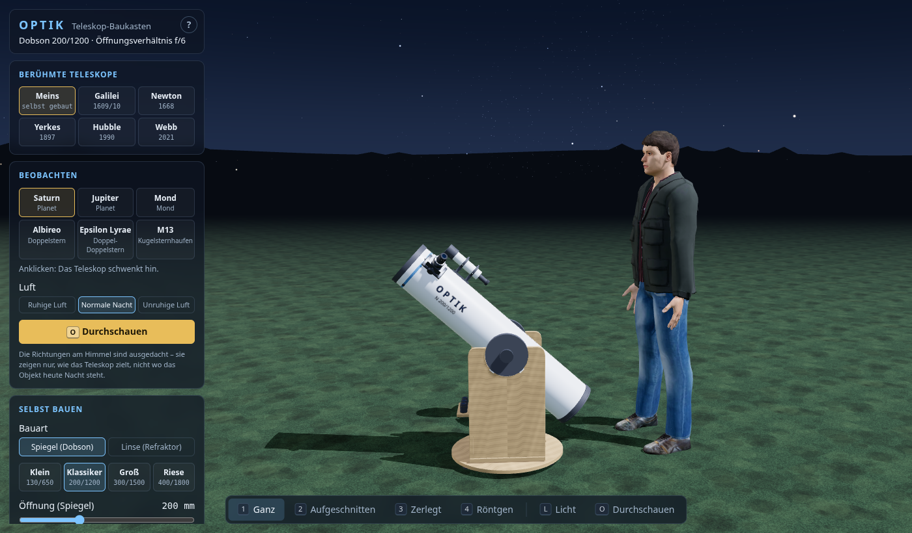
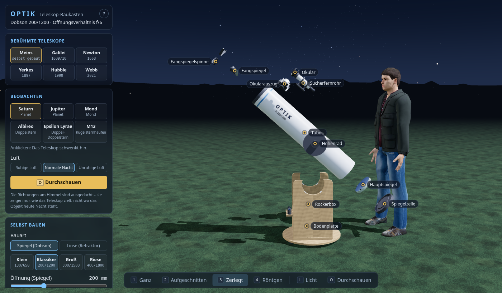
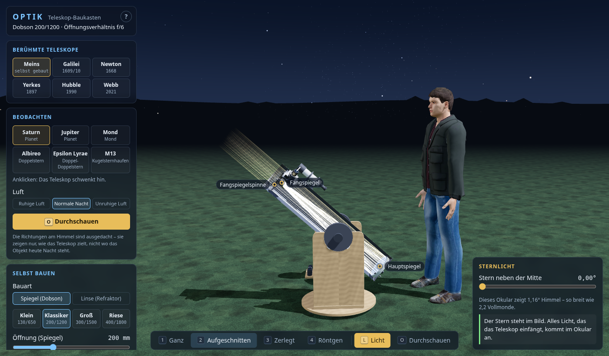
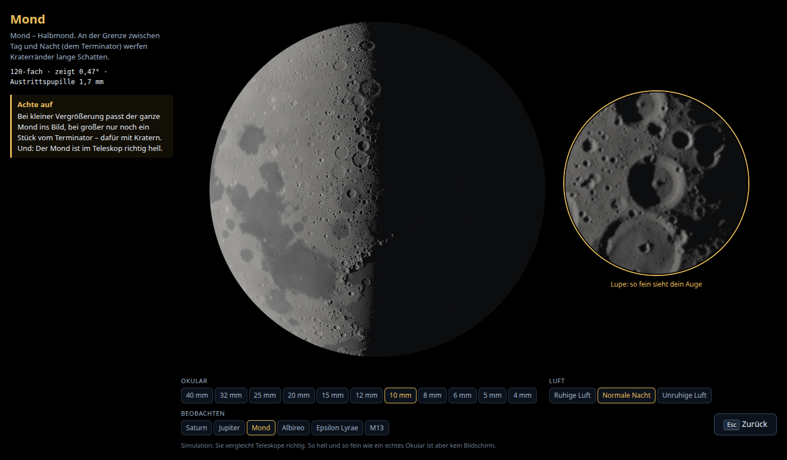
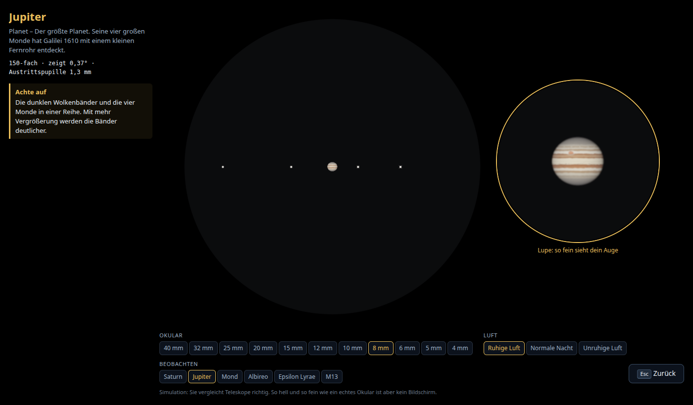
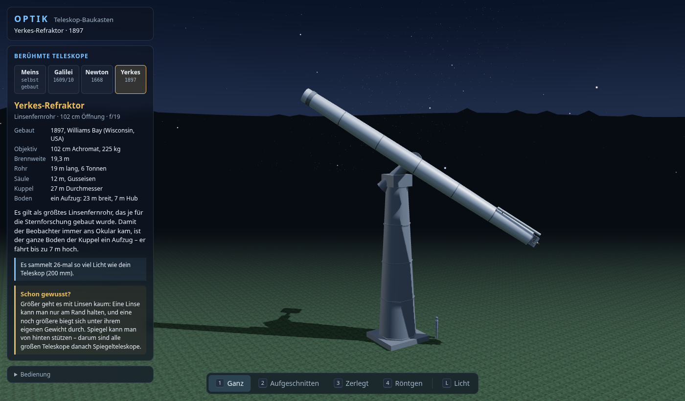
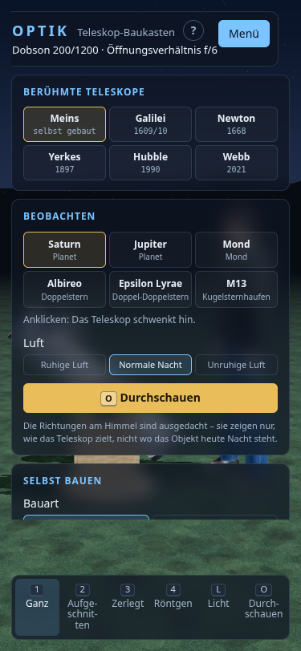

# OPTIK – Teleskop-Baukasten

**OPTIK – by Julian Harder**

Ein Teleskop in 3D unter einem Sternenhimmel – zum Drehen, Aufschrauben,
Selbstbauen und Hindurchschauen.



Ich hatte selbst einmal ein Teleskop und interessiere mich seitdem fürs
Weltall. OPTIK geht der Frage nach, was ein Teleskop eigentlich gut macht –
nicht die Vergrößerung, sondern die Öffnung, die Form der Spiegel, das Glas
und die Luft darüber.

## Was man tun kann

**Aufschrauben.** Das Teleskop lässt sich aufschneiden, in seine Teile
zerlegen oder durchsichtig machen. Ein Klick auf ein Teil erklärt, wozu es
da ist und woraus es besteht.



**Licht sehen.** Das Licht eines Sterns läuft sichtbar durch das Rohr: vom
Hauptspiegel zum Fangspiegel und ins Okular. Schiebt man den Stern aus der
Mitte, sieht man, wann sein Licht das Okular verfehlt.



**Selbst bauen.** Spiegelteleskop oder Linsenfernrohr, Öffnung, Brennweite
und Okular – das Teleskop baut sich sofort um. Ein Datenblatt mit Ampeln
sagt, was es taugt.

**Durchschauen.** Saturn, Jupiter, der Mond, zwei Doppelsterne und ein
Kugelsternhaufen – so, wie genau dieses Teleskop sie zeigen würde, in echter
Größe im Gesichtsfeld. Eine Lupe zeigt die Bildmitte so fein, wie das Auge
im Okular sieht.





**Berühmte Teleskope.** Galileis Fernrohr (1609/10), Newtons erstes
Spiegelteleskop (1668), der Yerkes-Refraktor (1897) und im All Hubble
(1990, mit seinem berühmten Spiegelfehler zum Einschalten) und Webb (2021) –
mit Steckbrief, zum Aufschrauben und, bis auf Webb, zum Durchschauen.




Beim ersten Öffnen erklärt eine kurze Führung das Wichtigste; man kann sie
überspringen und später mit `?` oder `H` wieder aufrufen. Auf dem Handy
liegen die Leisten hinter dem Knopf „Menü“.



## Starten

`index.html` doppelklicken. Kein Server, kein Build, keine Installation. Die
Seite lädt **nichts** aus dem Netz. Gebraucht wird ein Browser mit WebGL
(aktueller Firefox, Chrome oder Edge).

## Bedienung

| Eingabe | Wirkung |
| --- | --- |
| Ziehen | um das Teleskop herum drehen |
| Mausrad, zwei Finger kneifen | zoomen (das Mausrad zoomt zur Maus hin) |
| rechte Maustaste ziehen | verschieben |
| `1` `2` `3` `4` | ganz / aufgeschnitten / zerlegt / Röntgen |
| Klick auf ein Teil oder Schild | Infokarte: wozu, woraus, Zahlen, ein Fakt |
| `Esc` | Infokarte schließen |
| `L` | Sternlicht an/aus; Regler: Stern neben die Mitte schieben |
| `O` / Durchschauen | durchs Okular schauen (vorher schwenkt das Teleskop zum Objekt), `Esc` zurück – auch durch Galileis, Newtons und das Yerkes-Teleskop |
| Links: Berühmte Teleskope | Galilei, Newton, Yerkes, Hubble, Webb – mit Steckbrief; „Meins“ zurück zum eigenen |
| Links: Beobachten | Objekt und Luft wählen |
| Links: Selbst bauen | Vorlagen, Öffnung, Brennweite, Okular – das Teleskop baut sich sofort um |
| Links: Datenblatt | Zeile anklicken für die Erklärung |
| `F` | ganzes Teleskop zeigen |
| `H`, Knopf `?` | Hilfe (die kurze Führung vom Start) |
| `P` | Bildrate ein/aus (steht still bei 0, wenn sich nichts bewegt) |

## Was daran stimmt

Das Licht ist nicht aufgemalt: Jeder Strahl wird durch Parabolspiegel,
Fangspiegel, Feldblende und Okular verfolgt. Alle treffen sich auf
10⁻¹² mm genau im Brennpunkt, der Fangspiegel schattet 6,3 % der Fläche ab,
und am Bildrand wird es dunkler, weil dort Licht den Fangspiegel verfehlt –
wie bei echten Newton-Teleskopen.

Beim Linsenfernrohr wird jeder Strahl in drei Farben durch echtes Glas
gerechnet (Sellmeier-Formel, Kron- und Flintglas): Bei einer einzelnen
Linse liegen der rote und der blaue Brennpunkt 9,3 mm auseinander (die
Faustregel f/V sagt 9,4 mm), beim Achromat, aus der Formel berechnet, nur
0,15 mm. Im Okular wird daraus ein violetter Saum.

Der Blick durchs Okular rechnet mit echten Winkelgrößen (Saturn 18″, die
Cassini-Teilung 0,7″), mit der Unschärfe aus Beugung und Luftunruhe, der
Helligkeit nach der Austrittspupille und der Grenzgröße für Sterne. Bei
ruhiger Luft zeigt ein 300-mm-Spiegel die Cassini-Teilung mit 67 %
Kontrast, ein 100-mm-Spiegel mit 28 % – bei unruhiger Luft keiner von
beiden. Ein Bildschirm hat zu wenig Pixel für das, was das Auge im Okular
sieht; deshalb zeigt eine Lupe die Bildmitte so fein wie das Auge.

Mond und Planeten sind nicht gemalt, sondern Bildpunkt für Bildpunkt
gerechnet. Der Mond hat seine Mare, 57 große Krater und die Apenninen,
den Kaukasus und die Alpen an den echten Orten, dazwischen viele kleine
Krater; die Sonne steht flach, und Kraterwälle und Berge werfen am
Terminator lange Schatten. Jupiter und Saturn sind abgeplattete Kugeln mit
Wolkenbändern an den richtigen Breiten, die zum Rand hin dunkler werden;
Saturns Ringe haben ihren echten Helligkeitsverlauf mit Cassini- und
Encke-Teilung und werfen Schatten auf die Kugel.

Das Modell ist vereinfacht, aber die Maße kommen aus der Optik: Der
Hauptspiegel ist eine echte Parabel (bei 200/1200 am Rand 2,08 mm tief), der
Fangspiegel sitzt genau dort, wo der Brennpunkt oben im Okularauszug landet,
und ist gerade so groß, dass er den Lichtkegel nicht anschneidet. Geprüft
wird das ohne Browser:

```bash
node pruefungen/strahlen-test.js
```

## Bausteine

- [three.js](https://threejs.org) r128 (MIT-Lizenz), lokal in `lib/`
- der Mensch zum Größenvergleich: [MakeHuman](http://www.makehumancommunity.org)
  (Körper, Haut, Kleidung, Haare – CC0), eingebettet in `js/daten/modell-mensch.js`
- der Astronaut: Modell „Astronaut“ aus den
  [NASA 3D Resources](https://github.com/nasa/NASA-3D-Resources) (ohne
  Urheberrecht), eingebettet in `js/daten/modell-astronaut.js`
- Orte und Größen von Mare, Kratern und Gebirgen auf dem Mond sowie die
  Ringradien Saturns: Wikipedia (Quellen in `js/daten/mondkarte.js` und
  `js/okular/Planeten.js`), Teleskopdaten mit Quellen in `js/daten/`
- alles andere selbst geschrieben; alle übrigen Texturen werden beim Start gerechnet

---

Erstellt mit Unterstützung von KI (Claude).
