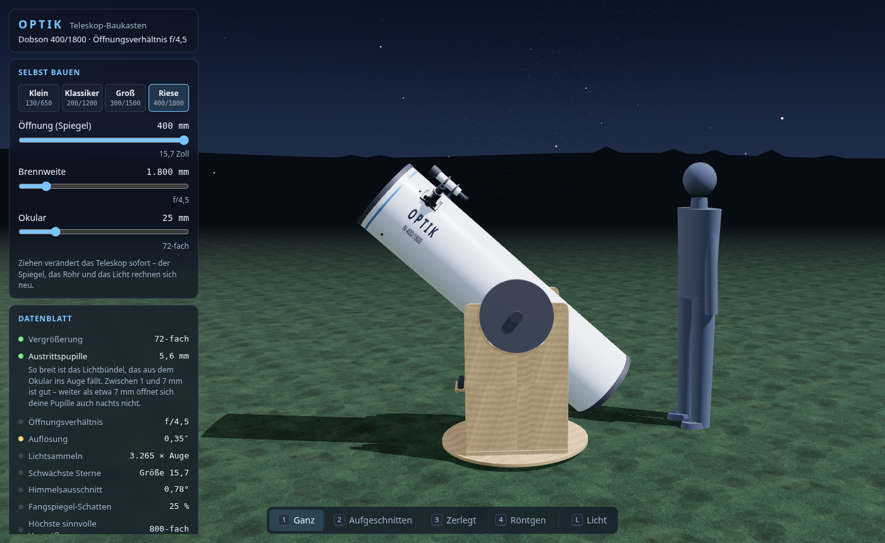

# OPTIK – Teleskop-Baukasten

Ein Teleskop in 3D unter einem Sternenhimmel – zum Drehen, Aufschrauben und
Durchschauen.



> **Im Aufbau.** Fertig sind Etappe 1 bis 4 von 8: ein Dobson-Teleskop zum
> Ansehen, Aufschneiden und Zerlegen, mit einer Erklärung zu jedem Teil,
> dem Licht eines Sterns, das man bis ins Okular laufen sieht – und alles
> selbst gebaut: Öffnung, Brennweite und Okular per Regler, mit Datenblatt
> und einem Menschen zum Größenvergleich. Was noch kommt – durchs Okular
> schauen, Linsenfernrohre, berühmte Teleskope – steht in
> [`OPTIK-Plan.md`](OPTIK-Plan.md).

## Starten

`index.html` doppelklicken. Kein Server, kein Build, keine Installation. Die
Seite lädt **nichts** aus dem Netz. Gebraucht wird ein Browser mit WebGL
(aktueller Firefox, Chrome oder Edge).

## Bedienung

| Eingabe | Wirkung |
| --- | --- |
| Ziehen | um das Teleskop herum drehen |
| Mausrad, zwei Finger kneifen | zoomen |
| rechte Maustaste ziehen | verschieben |
| `1` `2` `3` `4` | ganz / aufgeschnitten / zerlegt / Röntgen |
| Klick auf ein Teil oder Schild | Infokarte: wozu, woraus, Zahlen, ein Fakt |
| `Esc` | Infokarte schließen |
| `L` | Sternlicht an/aus; Regler: Stern neben die Mitte schieben |
| Links: Selbst bauen | Vorlagen, Öffnung, Brennweite, Okular – das Teleskop baut sich sofort um |
| Links: Datenblatt | Zeile anklicken für die Erklärung |
| `F` | ganzes Teleskop zeigen |
| `P` | Bildrate ein/aus (steht still bei 0, wenn sich nichts bewegt) |

## Was daran stimmt

Das Licht ist nicht aufgemalt: Jeder Strahl wird durch Parabolspiegel,
Fangspiegel, Feldblende und Okular verfolgt. Alle treffen sich auf
10⁻¹² mm genau im Brennpunkt, der Fangspiegel schattet 6,3 % der Fläche ab,
und am Bildrand wird es dunkler, weil dort Licht den Fangspiegel verfehlt –
wie bei echten Newton-Teleskopen.

Das Modell ist vereinfacht, aber die Maße kommen aus der Optik: Der
Hauptspiegel ist eine echte Parabel (bei 200/1200 am Rand 2,08 mm tief), der
Fangspiegel sitzt genau dort, wo der Brennpunkt oben im Okularauszug landet,
und ist gerade so groß, dass er den Lichtkegel nicht anschneidet. Geprüft
wird das ohne Browser:

```bash
node pruefungen/strahlen-test.js
```

## Bausteine

- [three.js](https://threejs.org) r128 (MIT-Lizenz), lokal in `lib/`
- alles andere selbst geschrieben, alle Texturen werden beim Start gerechnet

---

Erstellt mit Unterstützung von KI (Claude).
